# F1 Podium Prediction — Project Summary and Milestone 1 Deliverables

CSEN 903 Milestone 1 · Team: Omar Osama (58-7197) · Mohamed Ayman (58-13475) · Moataz Ashraf (58-7852) · Omar Emad (58-14543)

This document walks through the whole project in order and then goes through **every deliverable the Milestone 1 brief asks for**. For each one it gives what the brief requires, where we deliver it and the results. All numbers come from the committed, fully executed notebook; a fresh Run All reproduces every output table exactly.

| File | Contents |
|---|---|
| [`F1_Podium_Prediction.ipynb`](F1_Podium_Prediction.ipynb) | The single run-all notebook (§1–§18 below refer to its sections) |
| [`report/F1_Podium_Prediction_Report.pdf`](report/F1_Podium_Prediction_Report.pdf) | The analytical report (report sections are written "Report §x") |
| [`DECISION_LOG.md`](DECISION_LOG.md) | Every decision with the evidence behind it |
| `outputs/`, `outputs/figures/`, `codebooks/` | Every table (28 CSVs), figure (37 PNGs) and codebook (4 CSVs) the notebook writes |

---

## Part 1 — The project in one page

**Task.** For every driver in every race, predict whether they finish on the podium (`positionOrder <= 3`) using only information available **after qualifying and before the race starts**. Binary classification; the unit of analysis is one driver entering one race.

**Prediction cutoff.** Anything known once the grid is set (qualifying, grid position and penalties, sprint result, standings and form from *earlier* races) may be a feature. Anything from the race itself (finishing position, points, status, laps, pit stops, lap times, post-race standings) is leakage and is never a feature.

```mermaid
flowchart LR
    A[14 raw CSVs<br/>never modified] --> B[Audit<br/>sentinels, keys, grain]
    B --> C[EDA before cleaning]
    C --> D[Cleaning on copies<br/>fixed steps + D1–D16]
    D --> E[Audit & EDA after]
    E --> F[Data questions<br/>Q1, Q2, Q3]
    E --> G[Modelling table<br/>1 row per race-driver<br/>leakage-safe features]
    G --> H[Feature selection<br/>train seasons only]
    H --> I[Season split<br/>≤2019 / 2020–21 / 2022–24]
    I --> J[Preprocessing<br/>+ order experiments]
    J --> K[Models: grid rule, LR, RF,<br/>gradient boosting, shallow NN]
    K --> L[Test once, bootstrap CIs,<br/>scope & split sensitivity]
    L --> M[Experiments: ablation,<br/>form window, lineage]
    M --> N[XAI: permutation, SHAP, LIME]
    N --> O[Inference function]
    O --> P[Report + decision log]
```

### The flow, step by step (notebook sections)

| Step | Notebook | What happens | Key result |
|---|---|---|---|
| 1. Setup | §1 | Imports, seed 42, data folder auto-detection (Kaggle or `./data`), split constants | Split: train ≤ 2019, validation 2020–21, test 2022–24 |
| 2. Load | §2 | All 14 CSVs read **as strings**, so sentinels stay visible; a hash of the raw data is taken | Raw `results`: 26,759 rows |
| 3. Audit before | §3 | Sentinel scan, primary keys, natural grain, foreign keys | All PKs and FKs valid; **176 result rows in 85 duplicated (race, driver) pairs** |
| 4. EDA before | §4 | Table coverage per season, qualifying coverage, duration formats, category spellings, grid = 0 | Qualifying exists from 1994, complete only from 2003 |
| 5. Cleaning | §5 | Strip/unescape → sentinels → NaN → typing → durations → D1–D16 | `results` 26,759 → 24,755 rows; 0 parse failures |
| 6. After | §6 | Final key/grain/FK assertions, raw hash check, before/after tables and plots | All checks pass; raw data unchanged |
| 7. Data questions | §7 | Q1 front-row conversion, Q2 home advantage, Q3 mechanical retirements | See Deliverable 8 |
| 8. Modelling table | §8 | 36 candidate features, explicit allowed list, 300-row leakage test | 7,905 rows × 1 per (raceId, driverId) |
| 9. Feature selection | §9 | Univariate evidence on training seasons; redundancy filter | 26 of 36 features kept |
| 10. Split | §10 | By season; whole races stay together | 5,768 / 780 / 1,357 rows |
| 11. Preprocessing | §11 | Median imputation + missing indicators + scaling; effect on distributions plotted | — |
| 12. Evaluation harness + E1–E3 | §12, §12.1 | Five metrics; threshold chosen on validation; preprocessing-order experiments, each in its own cell | PR-AUC primary, F1 secondary; indicators +0.010 PR-AUC |
| 13. Models | §13 | Grid rule → LR baseline → tuned LR → RF → tuned RF → gradient boosting → NN → tuned NN; calibration | All learned models beat the grid rule |
| 14. Test | §14 | Final model chosen on validation, test scored once; bootstrap CIs; scope and split sensitivity | Test PR-AUC **0.698** vs grid rule 0.647 |
| 15. Experiments | §15 | Ablation (with CIs), form window, constructor lineage, feature-set check | Starting position is the core signal |
| 16. XAI | §16 | Permutation importance, global SHAP, local SHAP + LIME | `quali_pos` dominates; not causal |
| 17. Inference | §17 | `predict_podium(entry)` from raw pre-race inputs | Complete, no-qualifying and debutant demos |
| 18. Report material | §18 | Decision table, cleaning summary, figure/table list | — |

---

## Part 2 — The deliverables, one by one

The brief lists eight deliverables. Each section below covers: **what the brief asks → what we deliver and where → results**.

---

### Deliverable 1 — One run-all Jupyter notebook

**The brief asks for:** one notebook containing the audit, cleaning, data-engineering answers, feature engineering, modelling, experiments, XAI and the inference function, with every conclusion backed by a plot, statistic or controlled experiment. It must run top to bottom with a single Run All, with no hidden manual cells, sectioned for easy navigation.

**What we deliver:** [`F1_Podium_Prediction.ipynb`](F1_Podium_Prediction.ipynb) — 179 cells (99 code), 18 numbered sections with a contents table in the first cell.

**Results:**
- Runs top to bottom with **0 errors**, all 99 code cells executed in order (execution counts 1–99), about 8 minutes on a laptop CPU.
- **Reproducible:** a fresh run with all outputs stripped regenerated every CSV in `outputs/` byte-for-byte; seeds are fixed (NumPy, scikit-learn, TensorFlow).
- No result is hard-coded: every metric is computed by `roc_auc_score`, `average_precision_score`, `f1_score` etc. on model predictions.
- Every decision is marked `# DECISION:` in the code and justified in the markdown next to it; every interpretation sits in a ✍️ **WRITE-UP** cell under the evidence it interprets.
- Works on Kaggle: the data folder is found automatically; `shap` and `lime` install themselves if missing (Internet must be ON).

---

### Deliverable 2 — EDA with plots (before and after cleaning)

**The brief asks for:** exploratory data analysis before *and* after cleaning, showing the impact of cleaning, supported by proper visualisations, not by manual inspection; each implementation choice justified.

**What we deliver:** §3–§4 (before), §6 (after). Report §2 (Figures 1–5, Appendix B).

**Results — before cleaning:**

| Finding | Evidence (figure) | What it led to |
|---|---|---|
| `\N` sentinels concentrated in *structural* columns (session times from 2021, fastest-lap data from 2004) and *outcome* columns (`results.time` 71.3 %, `position` 40.9 %); only `q2`/`q3` are missing for a pre-race reason (knocked out) | Sentinel heatmap (`audit_sentinels_heatmap`) | Sentinel → NaN; every missing column labelled structural / outcome / pre-race-informative (`missingness_types.csv`) |
| Qualifying data starts in 1994 but covers only 6–59 % of entries in 1996–2002; complete from 2003 | `eda_raw_quali_coverage`, `eda_raw_table_coverage` | Modelling scope 2006+ (D1), tested empirically in §14.2 |
| Lap times start 1996, pit stops 2011, sprints 2021 (asserted on our copy) | Coverage heatmap | `pit_data_available` flag; sprint features unusable for training |
| 176 rows form 85 duplicated (race, driver) pairs, almost all 1950s shared drives | `audit_duplicates_per_year` | Shared-drive merge rule (D3) |
| Durations in three formats (`m:ss.sss`, `mm:ss.sss`, `h:mm:ss.sss`); `results.time` mixes absolute times and gaps (22 formats) | Format "shapes" table | One duration parser; `results.time` dropped |
| `'Argentinian '` (trailing space), `'USA'` vs `'United States'`, one HTML entity | Category listing + whitespace scan | Strip / unescape; ISO-3166 codes (D15) |
| `grid = 0` mostly non-qualifiers, plus 77 modern pit-lane starts and 45 old unknown slots | `eda_raw_season_overview` | D2 (drop non-starters), D5 (pit lane → back of grid) |

**Results — after cleaning (impact):**
- `results`: 26,759 → **24,755** rows: −405 (Indianapolis 500, D4), −1,535 (non-starters with no grid slot, D2), −64 (125 shared-drive rows merged into 61, D3).
- Missing share in original columns barely moves (22.8 % → 21.9 %): cleaning converts sentinels, it does not invent values.
- Outliers: 481 pit stops outside [1.5 s, 120 s] (e.g. 51-minute red-flag "stops") and 1 qualifying time (16:42.640) set to NaN; a robust z-score would have removed 1,491 genuine slow stops (13 %).
- Lap cleaning: 589,081 laps → 513,483 clean laps → `pace_ratio` for 10,655 driver-races.
- Class balance: podiums are 13.6 % of all rows, 14.2 % in the modern scope.
- Plots: `cleaning_before_after`, `cleaning_outliers_before_after`, `audit_nan_heatmap_after`, `eda_clean_durations`, `eda_clean_grain_and_base_rate`.

---

### Deliverable 3 — Unique driver–race modelling table, leakage-safe features

**The brief asks for:** exactly one row per (raceId, driverId), documented duplicate handling, sentinel handling and semantic typing, PK/FK verification, raw CSVs immutable, and leakage-safe form, standings, grid and qualifying features (form must use only past races).

**What we deliver:** §5 (cleaning), §8 (table + leakage test), `outputs/modeling_table.csv`. Report §2, §4.

**Cleaning results (all asserted in code):**

| Requirement | How | Result |
|---|---|---|
| Sentinels (`\N`, `""`, `NULL`, …) | Strip → `html.unescape` → NaN | 0 `\N` left anywhere (asserted) |
| Semantic typing | IDs → `Int64`, points → float, dates → datetime, times of day → timedelta, durations → seconds | Missing after typing = sentinels before → **0 parse failures** (asserted) |
| Grain (raceId, driverId) unique | **D3 shared drives:** merge the duplicate rows; pre-race fields (grid, constructor) from the car the driver *started* in (earliest `resultId`); outcome fields: points summed, best `positionOrder` → podium if any car made the podium | 125 rows → 61 driver-races; grain unique (asserted). "Keep the earliest row" would have dropped 18 real podiums; "keep the best row" would pick pre-race fields by the outcome |
| PK unique + non-null, FKs reconcile | Checked before cleaning and **re-asserted after every step that changes rows** | All pass; every child table of the 11 removed Indy races is removed too, so FKs stay intact |
| Raw CSVs immutable | Cleaning works on copies; SHA-256 hash of raw data checked at the end | Hash matches |

**Other cleaning decisions (D1–D16, each logged to `outputs/cleaning_log.csv`):** D1 modern scope 2006–2024; D2 drop entries with no grid slot (1,535: DNQ 1,025, DNPQ 331, Withdrew with grid 0 164, 107 % rule 9, Excluded 6) but keep 84 "Withdrew" rows that had a grid slot; D4 exclude the Indianapolis 500 (11 races); D5 modern `grid = 0` → back of the grid + `pitlane_start` flag; D6 missing features (domain fill, then train median + indicator); D7 round-1 standings from last season; D8 hard outlier limits; D9 clean lap pace; D10 target `positionOrder <= 3` (all 375 modern races have exactly 3 podiums, asserted); D11 status codebook (139 labels → 7 groups); D12 constructor lineage (renamed teams → families); D13 scale-free standings; D14 sprints; D15 ISO codes (0 unmapped); D16 abnormal-race flag (reporting only).

**The modelling table:**
- **7,905 rows** (2006–2024), one per (raceId, driverId) — asserted unique; target has no missing values.
- 36 candidate features, written to an **explicit allowed list**; the table is asserted to contain only allowed features, IDs and the target. `positionOrder`, points and status are used only to build the target and, shifted by one race, past-only history features.

| Group | Features (26 selected) | Why valid at the cutoff |
|---|---|---|
| Grid | `pitlane_start`, `grid_minus_quali` (penalties), `field_size` | Known once the grid is set |
| Qualifying | `quali_pos`, `gap_to_pole_pct`, `reached_q2`, `reached_q3` | Qualifying ends before the race |
| Standings | `drv_champ_rank`, `con_champ_rank`, `con_gap_to_leader_share`, `is_round_1` | Standings after the **previous** round; round 1 uses last season's final standings |
| Driver form | `drv_avg_finish_lastN`, `drv_podium_rate_lastN`, `drv_finish_rate_lastN`, `drv_pts_frac_lastN` | Rolling mean over the driver's previous 5 races (`shift(1)`) |
| Constructor form | `con_podiums_lastN`, `con_pts_frac_lastN` | Previous 5 races of the team, aggregated per race first (team-mates' current results can't leak) |
| Pace / pit | `drv_pace_ratio_lastN`, `con_pit_ratio_lastN`, `pit_data_available` | Clean-lap pace and pit-crew speed from earlier races only |
| Experience | `drv_career_starts`, `drv_career_podiums`, `drv_circuit_visits`, `drv_circuit_podium_rate`, `drv_circuit_first_visit`, `drv_age` | Counts over earlier races; age at race date |

**Leakage proof (two independent tests):**
1. §8.1: for 300 random rows, form, points-share, pace and pit features are recomputed from races with an earlier date only — they match the vectorised features exactly; standings are asserted to come from an earlier-dated race (previous season for round 1).
2. §17: the inference function rebuilds every feature from raw inputs using only races dated before the entry, and reproduces the table for 300 random validation/test rows.

---

### Deliverable 4 — Model comparison table (statistical models + shallow NN)

**The brief asks for:** at least two statistical ML models and a shallow neural network (1–2 hidden layers), trained on the same rows and features; a baseline; at least three distinct modelling attempts; ROC-AUC, PR-AUC and F1 for every model on training/validation and the unseen test set; thresholds and hyperparameters chosen on training/validation only; primary/secondary metric justified; each model's working and limitations explained; justified split.

**What we deliver:** §10 (split), §12–§14; `outputs/model_comparison.csv`, `bootstrap_ci.csv`, `tuning_*.csv`. Report §5–§6 (Tables 8–11).

**Split (§10):** by season, with the course guide's boundaries — **train 2006–2019** (5,768 rows, 268 races, 13.9 % podiums), **validation 2020–21** (780 rows, 39 races, 15.0 %), **test 2022–24** (1,357 rows, 68 races, 15.0 %). Rows are not independent (form carries over, the sport drifts), so a random split would leak the future into training. The test set is the whole ground-effect regulation era, so it measures how a model trained on the hybrid era carries over to a rule change.

**Models (eight attempts, each in its own cell):**

| Model | How it works | Limitation | Settings (chosen on validation) |
|---|---|---|---|
| Grid rule (reference) | Score = 1 / grid position | Not learned | — |
| **Logistic regression (baseline)** | Weighted sum of standardised features → sigmoid; log-loss + L2; balanced class weights | Only linear, additive effects; correlated features share weights | C = 1 (C = 10 tied) |
| Random forest | Many trees on bootstrap samples, votes averaged | Deep trees memorise; step-shaped predictions | Default, and tuned depth 12 / leaf 20 |
| Gradient boosting (histogram) | Shallow trees added one after another, each fitting the previous errors | More hyperparameters; overfits easily | Learning rate 0.03, depth 3, leaf 100 |
| Shallow FFNN (Keras) | 1–2 ReLU layers, sigmoid output, Adam, dropout + L2 + early stopping on validation PR-AUC | Stochastic, needs scaling, hard to interpret | Starting 32-16 / dropout 0.2; tuned: one layer of 64, dropout 0.4 |

**Results — all five metrics (threshold chosen on validation):**

| Model | Val ROC-AUC | Val PR-AUC | Val F1 | Test ROC-AUC | **Test PR-AUC** | Test F1 | Test precision | Test recall | Train PR-AUC |
|---|---|---|---|---|---|---|---|---|---|
| Grid rule | 0.909 | 0.639 | 0.692 | 0.914 | 0.647 | 0.649 | 0.650 | 0.647 | 0.645 |
| **LR, C = 1 (final)** | **0.936** | **0.745** | **0.714** | **0.934** | **0.698** | **0.690** | 0.599 | 0.814 | 0.711 |
| LR, tuned (C = 10) | 0.936 | 0.746 | 0.714 | 0.934 | 0.699 | 0.690 | 0.599 | 0.814 | 0.710 |
| RF, default | 0.923 | 0.689 | 0.714 | 0.926 | 0.642 | 0.653 | 0.604 | 0.711 | 1.000 |
| RF, tuned | 0.929 | 0.729 | 0.716 | 0.932 | 0.682 | 0.642 | 0.647 | 0.637 | 0.776 |
| Gradient boosting | 0.933 | 0.739 | 0.710 | 0.930 | 0.693 | 0.654 | 0.650 | 0.657 | 0.755 |
| FFNN, starting | 0.924 | 0.721 | 0.714 | 0.930 | 0.683 | 0.648 | 0.630 | 0.667 | 0.749 |
| FFNN, tuned | 0.929 | 0.735 | 0.714 | 0.928 | 0.680 | 0.652 | 0.634 | 0.672 | 0.714 |

- **Metric choice.** *Primary: PR-AUC* — podiums are only ~15 % of rows and the task is ranking podium finishers above the rest; ROC-AUC is inflated by the many easy back-markers (≈ 0.93 for every model, 0.91 even for the grid rule). *Secondary: F1* at the validation-chosen threshold — the quality of the actual yes/no call. Precision and recall are reported too (five metrics in total).
- **Threshold.** Max-F1 on validation (0.732 for the final model); it is at least as good as "top 3 per race" for every model (LR: 0.714 vs 0.709).
- **Model choice (validation only):** the simplest model within 0.005 of the best validation PR-AUC → **LR with C = 1**.
- **Test result:** PR-AUC **0.698**, ROC-AUC 0.934, F1 0.690; finds 166 of 204 podiums with 111 false alarms (TN 1,042, FN 38). **+0.051 over the grid rule.**
- **Is the difference real? (§14.1, race bootstrap, 1,000 resamples):** final model val 0.745 [0.636, 0.850], test 0.698 [0.637, 0.763]. Only the grid rule (test Δ −0.051 [−0.095, −0.003]) and the default forest are significantly worse; tuned RF, boosting and both networks are statistically tied with LR — so the simplest model is kept.
- **By test season:** 2022 0.660 (first ground-effect season), 2023 0.770 (one dominant team), 2024 0.664 (four winning teams).
- **Overfitting:** default RF train 1.000 vs validation 0.689 (memorises); LR train 0.711 vs validation 0.745 (no overfitting).
- **Calibration (§13.8):** class weighting makes raw scores over-confident (mean prediction 0.28 for a 15 % rate, Brier 0.095). Platt scaling fitted on validation fixes the probabilities (test Brier 0.112 → 0.069) without changing the ranking.
- **Sensitivity (§14.2–14.3):** modern training beats all-seasons training for LR and RF (val 0.745 vs 0.727); with the previous split the model still beats the grid rule by +0.05.
- **Plots:** validation ROC/PR curves, test confusion matrix + PR curves + calibration, tuning plots (LR, RF, GB, NN), NN training curves, bootstrap intervals.

---

### Deliverable 5 — Feature-group ablation and preprocessing-order experiments

**The brief asks for:** remove one feature group at a time and re-train to measure each group's contribution after training (complementing the pre-training exploratory evidence), reported per group; and at least two preprocessing-order experiments; effect of preprocessing on distribution/range/values.

**What we deliver:** §11 (preprocessing), §12.1 (E1–E3, one cell each), §15 (ablation, form window, lineage, feature-set check). Report §5, §7 (Tables 7, 14–16, Figures 11, 16).

**Preprocessing (§11; experiments in §12.1):** median imputation with missing-value indicators, then standardisation (tree models skip scaling), fitted on training seasons only. The effect is plotted for five features (raw vs imputed + scaled: centred, unit variance, no NaN).

| Experiment (validation, logistic regression) | Variant A | Variant B | Conclusion |
|---|---|---|---|
| **E1 order:** impute → scale vs scale → impute | 0.7454 | 0.7422 | Small difference (only 2.7 % of cells imputed); impute first kept |
| **E2 order of fit vs split:** fit preprocessing on train only vs on all data (leaky) | 0.7454 | 0.7455 | No gain from leaking, so train-only fitting is kept on principle |
| **E3 missing indicators:** on vs off | 0.7454 | 0.7352 | **+0.010**: being missing is informative (debutant, new team, pre-2011) |

**Feature-group ablation (§15.1)** — final model (95 % paired race-bootstrap CI) and tuned RF (mean of 5 seeds ± std); threshold re-chosen each run; Δ = change in validation PR-AUC when the group is removed:

| Removed group | LR Δ val [95 % CI] | LR Δ test | RF Δ val |
|---|---|---|---|
| **grid + qualifying (starting position)** | **−0.114** [−0.153, −0.058] | −0.109 | −0.093 |
| **qualifying** | **−0.097** [−0.136, −0.043] | −0.104 | −0.068 |
| grid | −0.024 [−0.065, +0.007] | −0.010 | −0.012 |
| standings | −0.012 [−0.027, +0.003] | +0.005 | +0.011 |
| pace / pit | −0.009 [−0.020, +0.003] | +0.002 | −0.003 |
| driver form | −0.008 [−0.020, +0.009] | +0.006 | −0.010 |
| constructor form | −0.002 [−0.011, +0.007] | +0.003 | +0.007 |
| experience | −0.000 [−0.019, +0.019] | +0.008 | +0.014 |

**Interpretation:** only qualifying and the combined starting position have intervals that exclude 0. Standings, form and pace have high univariate AUC (≈ 0.89–0.92, §9) but most of that signal overlaps with the starting position: **univariate evidence measures signal, ablation measures unique signal.** The combined row matters because grid was dropped as a near-duplicate of `quali_pos`; removing either alone understates the starting position.

**Extra experiments (empirical justification of two design choices):**
- **Form window (§15.2):** N = 3 → Δ −0.013 [−0.022, −0.002] (worse), N = 10 → Δ −0.006 [−0.029, +0.014] (same). **N = 5 kept.**
- **Feature set (§15.4):** all 33 usable candidates vs the 26 selected → validation Δ +0.004 [−0.004, +0.014], test identical: the selection rule costs no accuracy; the 26 are kept for simplicity.
- **Constructor lineage vs plain `constructorId` (§15.3):** Δ −0.001 [−0.008, +0.005] — no accuracy difference. Families kept as a documented judgement call (a rename doesn't reset a real team's history; Q3 compares factories across eras).

---

### Deliverable 6 — Explainability: global (permutation importance, SHAP) and local (LIME / local SHAP)

**The brief asks for:** permutation importance and SHAP globally; at least one local explanation (LIME and/or local SHAP); all plotted and interpreted; an explicit statement that explanations are **not causal**.

**What we deliver:** §16 (on the final model). Report §8 (Figures 17–18, Appendix B).

**Results:**
- **Not causal (stated in the notebook and the report):** a feature being important means the model *relies* on it to predict, not that it *causes* podiums. Correlated features share and swap importance.
- **Permutation importance** (drop in validation PR-AUC when a feature is shuffled, 10 repeats): `quali_pos` **0.477**, `reached_q2` 0.069, `drv_career_podiums` 0.049, `gap_to_pole_pct` 0.027, `drv_pace_ratio_lastN` 0.024, `grid_minus_quali` 0.020.
- **Global SHAP** (bar + beeswarm, real units): `quali_pos` dominates, then `reached_q2`/`reached_q3`, recent pace, recent finishes, age, gap to pole. Better qualifying, smaller gap, faster recent pace and more career podiums push towards a podium; a pit-lane start and a grid penalty push strongly down.
- **Counter-intuitive signs explained:** `reached_q2` and `drv_age` push *down* because they are collinear with `quali_pos` and career podiums; in a linear model correlated features offset each other's weights — a concrete example of importance ≠ cause.
- **Local 1 — confident hit:** Lewis Hamilton, 2021 Spanish GP, pole: p = 0.98, won. SHAP and LIME both rank qualifying position first.
- **Local 2 — missed podium:** Sebastian Vettel, 2020 Turkish GP, qualified 12th in a wet session (6.9 % gap to pole): p = 0.04, finished 3rd in a wet race. SHAP shows the large gap and `reached_q2` pulling down, 120 career podiums pushing up. The outcome came from race conditions no pre-race model can see.
- **LIME vs SHAP:** LIME runs on the raw features through the full pipeline (rules read like "11 < quali_pos ≤ 17"); it agrees with SHAP on the main drivers. Its local surrogate fits well for the hit (R² 0.66) but weakly for the near-zero case (R² 0.29), so it is read qualitatively; SHAP is exact for a linear model.

---

### Deliverable 7 — Inference function (complete and partially missing record)

**The brief asks for:** an inference function, demonstrated on a complete record and on a partially missing one.

**What we deliver:** §17 — `predict_podium(entry)` with the helper `features_at_cutoff(entry)`. Report §9 (Table 17).

**How it works:**
- **Input = raw pre-race facts**, not engineered features: required `driverId`, `constructorId`, `circuitId`, race `date`, `grid` (0 = pit lane); optional qualifying position, gap to pole, Q2/Q3 flags, field size, sprint result.
- It builds all features itself from races dated before `date` (same definitions as §8), runs the fitted pipeline, and returns the model score, the **Platt-calibrated probability**, the yes/no call at the validation threshold, and which features were filled by a fallback or imputed.
- **Post-race fields are rejected** (passing `points` raises an error).
- **Missing qualifying → domain fallback:** `quali_pos` ← grid slot, Q2/Q3 flags from that position, gap ← training median for that position. Without it, the missing-value indicators would read "not known yet" as "set no time" (the only meaning missing qualifying had in training) and push the probability to ≈ 0.
- **Missing history** (a debutant) stays missing and is imputed, exactly as debutants were in training.

**Demo (Nico Hülkenberg, Haas, 2024 Abu Dhabi GP — qualified 4th, started 7th after a grid penalty, finished off the podium):**

| Record | Score | Calibrated probability | Prediction | Filled by fallback / imputed |
|---|---|---|---|---|
| Complete | 0.296 | 0.080 | no podium | 0 / 0 |
| No qualifying data (only grid) | 0.152 | 0.037 | no podium | 4 / 0 |
| Debutant (unknown driver, same car, starting 5th) | 0.327 | 0.090 | no podium | 3 / 8 |

The no-qualifying probability is lower because the fallback assumes he qualified where he started (7th) — it cannot see the penalty.

---

### Deliverable 8 — Analytical report (PDF)

**The brief asks for:** a report combining the written answers to the three data-engineering questions with figures, the selected features and why each is valid at the pre-race cutoff, and known limitations (e.g. qualifying-coverage drift, era sensitivity). The brief also asks for all plots and data-engineering answers in both the notebook and the report, and XAI plotted and explained in the report.

**What we deliver:** [`report/F1_Podium_Prediction_Report.pdf`](report/F1_Podium_Prediction_Report.pdf), generated from the notebook outputs by `report/build_report.py`. Contents: summary · task and data · audit and cleaning (D1–D16 table) · Q1–Q3 · modelling table and features (validity table) · split and preprocessing · models (all five metrics on validation and test, bootstrap, calibration) · experiments · XAI · inference · limitations · conclusion · appendices (codebook judgement calls, **every remaining figure**, reproducibility).

**The three data-engineering questions (multi-hop joins: results ⨝ races ⨝ circuits ⨝ drivers ⨝ constructors ⨝ status ⨝ qualifying):**

**Q1 — Which circuits convert a front-row start into a podium most often, and does the ranking change after 2014? (grid vs qualifying)**
- 2014–24: Suzuka 89 % (16/18), Yas Marina 86 %, Monaco 85 %. 2003–13: Magny-Cours 92 %, Monaco and Monza ≈ 77 %.
- **The ranking changes:** for the 15 circuits with ≥ 8 front-row starts in both eras, Spearman ρ = 0.21 (p = 0.46) with grid, 0.50 (p = 0.06) with qualifying. Monza falls from joint 1st to 11th; Yas Marina and Interlagos rise; conversion rises almost everywhere after 2014.
- **Grid ≠ qualifying:** the two front-row definitions disagree for 74 entries (8.6 %) because of penalties and pit-lane starts; both rankings are plotted.
- Grain: one row per driver-race, front-row starters; 2003+ only (complete qualifying); both inputs known before the start.

**Q2 — Do drivers podium more often at home, controlling for starting position?**
- Home = driver nationality and circuit country map to the same ISO code (0 unmapped).
- Crude odds ratio 0.84 (home looks *worse*: many home entries are one-off local drivers starting near the back). **Within six grid strata, Mantel–Haenszel OR = 0.95 (95 % CI 0.80–1.13) → no home advantage.**
- Same conclusion in every period: 1950–2005 0.95, 2006–24 0.87 (0.57–1.35). 24,710 starters, 1,941 at home.

**Q3 — Which constructors have the highest mechanical-retirement rate in 2014–2021 vs 2022–2024?**
- Mechanical = a race start that ended because a car component failed (status codebook D11: 57 mechanical labels; crashes, driver illness and regulation decisions excluded; 30 ambiguous labels counted both ways). Denominator = race starts.
- **2014–21:** Caterham 23.5 %, Toro Rosso / AlphaTauri 14.7 %, McLaren 13.5 % (Honda years), Lotus / Renault 13.5 %; most reliable Mercedes 3.8 %.
- **2022–24:** Alpine 11.0 %, Alfa Romeo / Sauber 8.1 %; most reliable Aston Martin 3.0 %. Rates roughly halve across the field.
- Per `constructorId` the leaders are the same (Lotus F1 17.3 %, Toro Rosso 16.1 %; Alfa Romeo 11.4 %). Robust to the ambiguous statuses (Spearman 0.95 / 0.85); Wilson 95 % intervals plotted.

**Known limitations (Report §10):** qualifying-coverage drift (complete only from 2003 → model restricted to 2006+); era sensitivity (test = new regulation era; 2022 hardest); small evaluation sets (39 / 68 races, intervals ±0.06–0.10); class-weighting distorts raw probabilities (calibrated); sprint features unusable while training ends in 2019, pit data only from 2011; small samples in Q1/Q2; judgement calls in the status and lineage codebooks; unpredictable race events (weather, first-lap incidents); the inference fallback hides a grid penalty.

